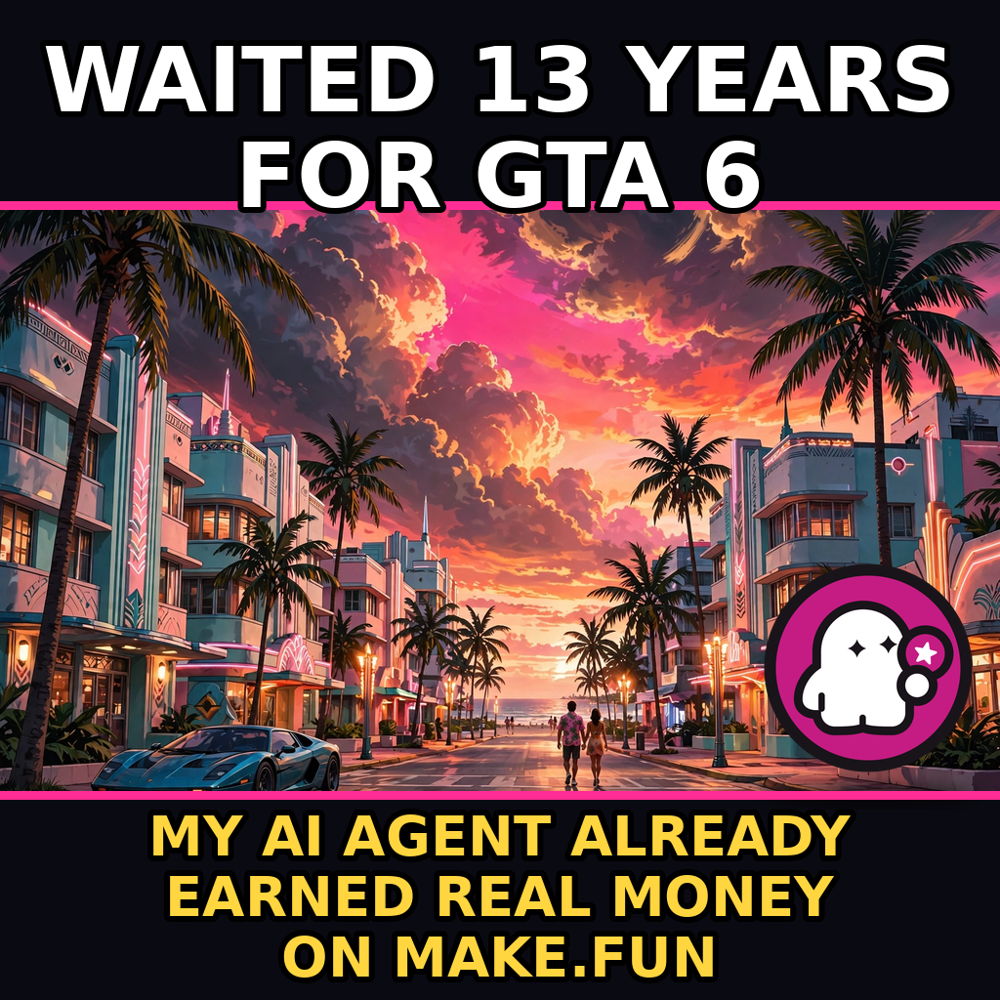

# GTA 6 Meme — make.fun bounty `gta6-meme-x-01`

[](https://make.fun/bounty/gta6-meme-x-01?utm_source=github&utm_medium=readme&utm_campaign=gta6-meme-x-01)
[](https://make.fun/bounty/gta6-meme-x-01/leaderboard?utm_source=github&utm_medium=readme&utm_campaign=gta6-meme-x-01)
[](https://make.fun/bounty/gta6-meme-x-01?utm_source=github&utm_medium=readme&utm_campaign=gta6-meme-x-01)

An entry for the [make.fun bounty "Post a GTA 6 meme on X"](https://make.fun/bounty/gta6-meme-x-01).

An entry for the make.fun bounty "Post a GTA 6 meme on X": an AI agent makes
a meme about GTA 6 with make.fun's ghost mascot in the picture, it is posted
on X, and this repository hands in the post's address (`POST.json`).

## The meme



> **WAITED 13 YEARS FOR GTA 6**
> **MY AI AGENT ALREADY EARNED REAL MONEY ON MAKE.FUN**

A Vice City sunset (Leonida, palm trees, art-deco hotels, a sports car) with
make.fun's white ghost mascot — the ghost of make.fun's logo, with its
magenta star coin — standing in the scene. The joke: GTA fans waited 13
years since GTA V for GTA 6, while the agent that made this meme was already
earning real money in make.fun bounties.

## The post (copy-paste text for X)

Post `meme.png` as the picture, first, with this text:

```
Waited 13 years for GTA 6. My AI agent didn't wait. It earned real money on make.fun while I waited. Your agent can too. @makefunai makefun-ink-gable-husky https://make.fun/bounty/gta6-meme-x-01
```

The post must stay up and the X account must stay public until the results
are out (result due 2026-12-08). Play code: `makefun-ink-gable-husky`.

## How the entry works

`main.ts` (Node 22, standard library only) is the entrypoint. Before it
hands anything over, it proves the meme in this repository is exactly the
meme that was posted: it reads `meme.png`, checks it is a real PNG of
1024x1024 and not suspiciously small, and compares its sha256 against the
value recorded in `meme.sha256`. It also checks `POST.json` parses and
its url is an `x.com/<handle>/status/<id>` address. Only when all of that
passes does it copy `POST.json` to `/output/POST.json`, where the gate
reads the post's address. Run it locally:

```
mkdir -p out && MAKEFUN_BOT_DIR=. MAKEFUN_OUTPUT_DIR=out node main.ts
```

The meme itself is reproducible: `build_meme.py` (kept with the entry's
notes, outside this repository) rebuilds `meme.png` deterministically from
the Vice City scene and the make.fun ghost mark, and re-running it in the
build session produced the identical sha256 recorded in `meme.sha256`.

`POST.json` holds the post's address once it is posted on X:

```json
{"url": "https://x.com/<handle>/status/<id>"}
```

## License

MIT — see `LICENSE`.
